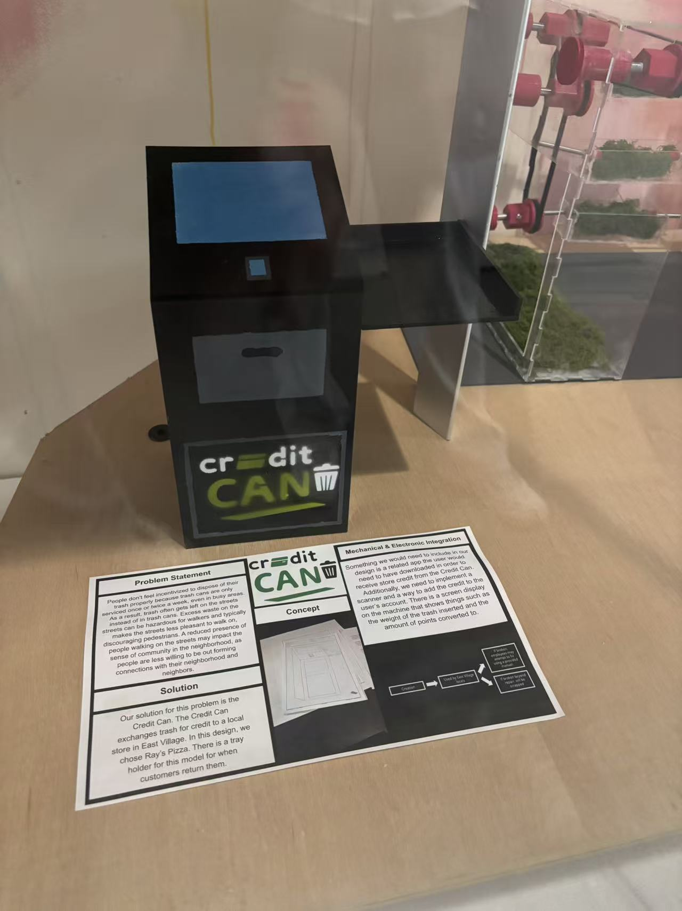

# CreditCAN

**Honor Award · Team design project at Cooper**

CreditCAN was a first-year team project. We designed a recycling station concept that would reward people with credit at nearby businesses for depositing items.

## Field research

We interviewed passersby about the condition of their neighborhood. Many said they were generally satisfied, yet we observed litter in the park and around nearby restaurants. That contrast led us to ask how we could encourage proper waste disposal in shared spaces.

## Design concept

We proposed a station that would display the weight of deposited items and the points earned. A scanner and app would connect those points to a user account, where they could be redeemed as store credit. Our team built and spray-painted a physical model and designed the CreditCAN logo.

## My contribution

A teammate and I raised public-space sanitation as a project theme. I proposed the automated collection bin, worked with the group to define its purpose and overall structure, and modeled the team prototype in Onshape.

[Back to my GitHub profile](https://github.com/jw3422951-ops)
