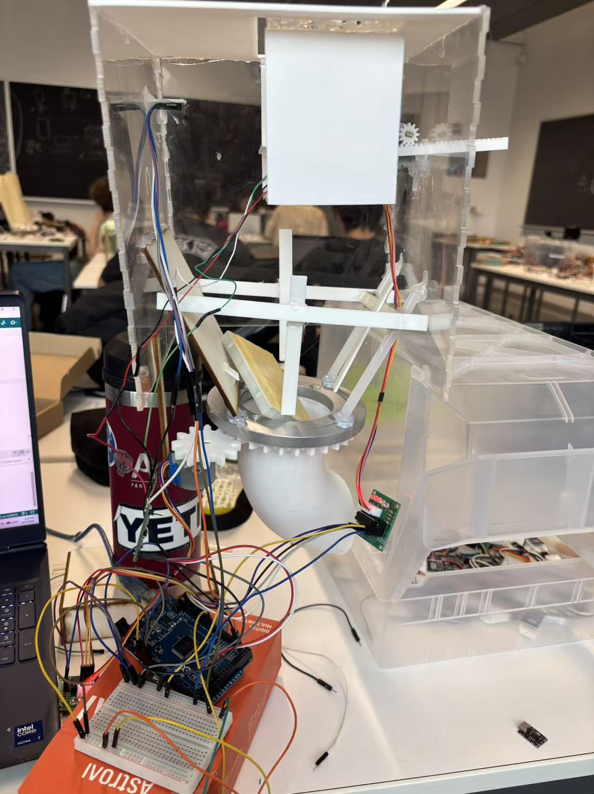
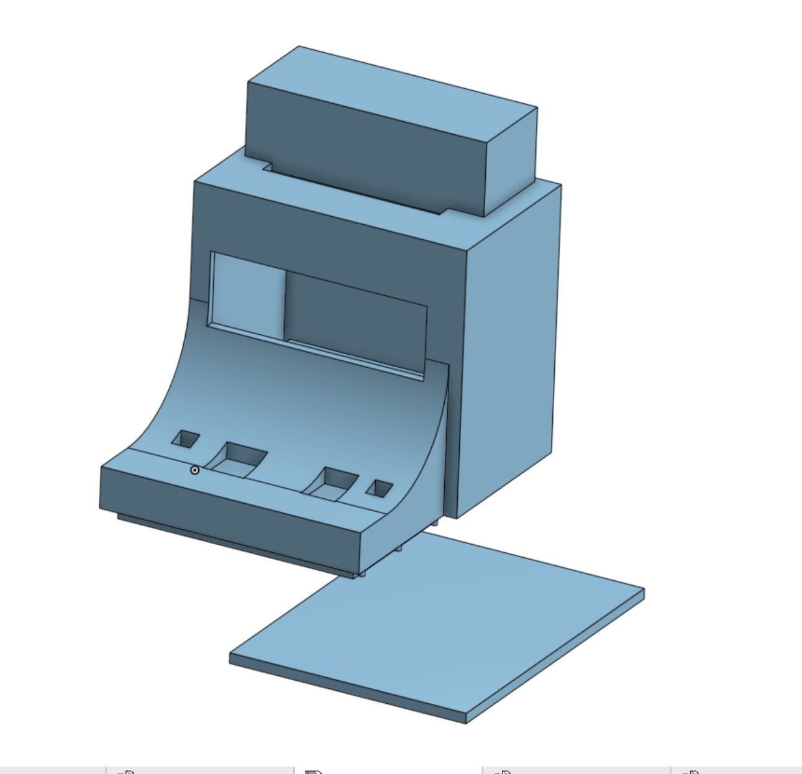

# Cooper Union Summer Projects

Over two summers at Cooper Union, I went from modeling a recycling station with a team to independently designing and building a working waste sorter.

[CreditCAN](#creditcan) · [Electronic game](#team-mini-project--electronic-game) · [Arduino exercises](#arduino-exercises)

## CreditCAN

### Independent waste sorter

**Year 2 · 2026**

I revised the mechanism during fabrication and integrated the sensors and motors with an Arduino Mega 2560.

#### Sensing and classification

| Input | Role |
| --- | --- |
| Inductive proximity sensor (NPN, normally closed) | Checks for metal. |
| VL53L0X time-of-flight sensor | Measures distance to the item, which the system uses to estimate its height. [Sensor documentation](https://www.st.com/en/imaging-and-photonics-solutions/vl53l0x.html) |
| Serial | I enter the item's mass manually in the working prototype. |

The sorter checks for metal first and uses thresholds for mass, height, and mass divided by height. The four routes are plastic bottles, aluminum cans, food waste, and rejects.

#### Mechanical layout and control

- **Top.** A fixed platform holds the item near the sensors.
- **Middle.** A ring gear and pinion turn the chute toward the selected route. A rack and pinion drive the pusher.
- **Bottom.** Fixed bins collect the sorted items.

I designed the finger-jointed enclosure in Onshape, laser-cut the panels, and generated the gears and racks with FeatureScript for 3D printing.

#### Firmware and motor sequence

I wrote the initial Arduino C++ sketch myself and used AI to help identify and correct errors. The sketch waits for a mass entry in the Serial Monitor, classifies the item, and runs the motor sequence. Step counts and classification thresholds are stored as named constants. [Open the Arduino Mega 2560 firmware](01-creditcan/firmware/CreditCAN/CreditCAN.ino)

The chute rotates to the selected bin when needed. The program waits two seconds, extends and retracts the pusher, and returns the chute to its starting position. I designed the sequence around the blocking `step()` calls in Arduino's standard `Stepper` library so that each move finishes before the next begins. Reducing simultaneous motor demand was a secondary consideration. [Arduino Stepper library source](https://github.com/arduino-libraries/Stepper/blob/master/src/Stepper.cpp#L175-L218)

An earlier bench test alternates individual steps between two motors to move them forward and back. This copy comes from the Arduino IDE build cache. [Open the dual-stepper bench test](01-creditcan/firmware/DualStepperTest/DualStepperTest.ino)

#### Future work

Integrate the load cell and HX711 to measure mass automatically. Then test whether the variance in load cell readings after a short vibration pulse can help identify partially filled containers.

### Year 1 · CreditCAN team concept

**3D Fabrication · Honor Award**

We interviewed passersby about neighborhood conditions. Many said they were generally satisfied, yet we observed litter in the park and around nearby restaurants. That contrast led us to ask how we could encourage proper waste disposal in shared spaces.

We designed CreditCAN as a station that would award credit at nearby businesses for deposited items. Our team built and spray-painted a display model and designed the logo. A teammate and I proposed public-space sanitation as the theme. I suggested an automated collection bin, helped define its purpose and overall structure, and modeled the team prototype in Onshape.

## Team mini-project · Electronic game

During my second summer, my team built a small electronic game with two push buttons, colored LEDs, and an LCD that displayed a replay prompt. I was responsible for the 3D modeling and helped debug the game.

**Game demonstration (2:41)**

https://github.com/user-attachments/assets/599749b5-15be-4854-b69c-446686e29c17

[Early reaction game sketch (Arduino Uno)](02-electronic-game/Game_v12/Game_v12.ino) uses a shared button for two players. The demonstration above shows the later build with two buttons and an LCD.

### CAD assembly

[Download the assembly file (STL)](02-electronic-game/electronic-game-assembly.stl?raw=true)

## Arduino exercises

In my second summer, I learned the basics of ESP32 Wi-Fi and Bluetooth and practiced working with motors, ultrasonic distance sensors, LEDs, and push buttons. I used classroom explanations and AI to understand how the components worked, then tried writing code for the exercises.

The sketches include a potentiometer-controlled servo, ultrasonic distance measurement with LED feedback, and exercises with joysticks, LEDs, and an I²C LCD. [Browse the Arduino exercises](03-arduino-exercises)

The class also covered assembly design, dimensional tolerances, and shaft and hole fits. I applied what I learned about clearance and fit when designing parts for later 3D modeling and laser-cut fabrication projects.

[Back to my GitHub profile](https://github.com/jw3422951-ops)
