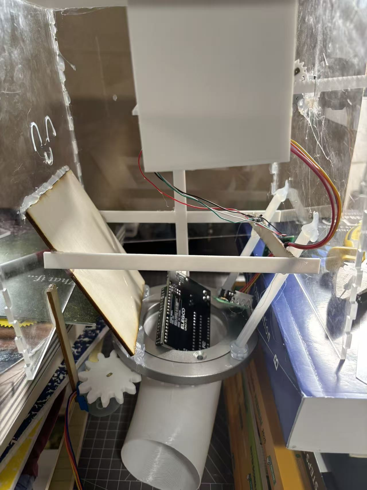
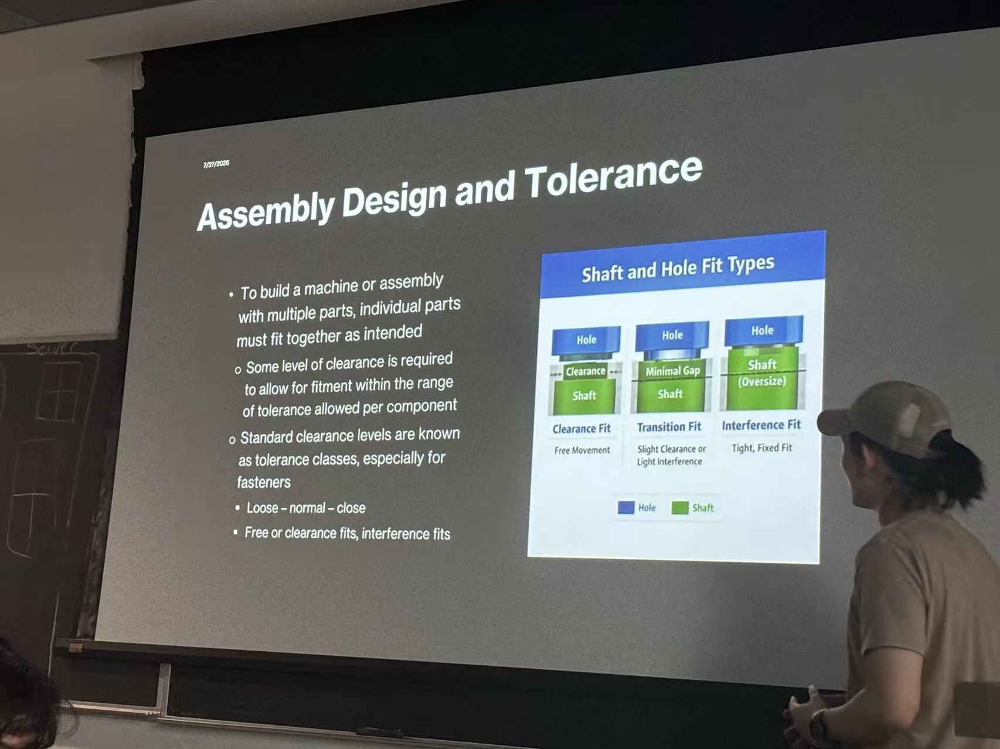
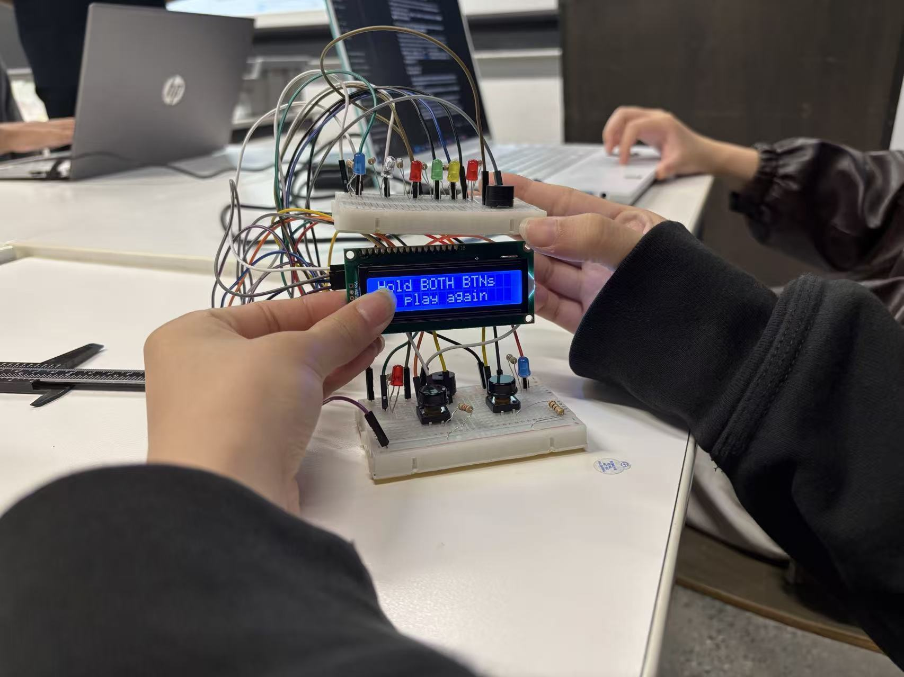

# Cooper Union Summer Projects

Over two summers at Cooper Union, I went from modeling a recycling station with a team to independently designing and building a working waste sorter.

## Independent waste sorter

**Year 2 · 2026**

I revised the mechanism during fabrication and integrated the sensors and motors with an Arduino Mega 2560.

### Sensing and classification

| Input | Role |
| --- | --- |
| Inductive proximity sensor (NPN, normally closed) | Checks for metal. |
| VL53L0X time-of-flight sensor | Measures distance to the item, which the system uses to estimate its height. [Sensor documentation](https://www.st.com/en/imaging-and-photonics-solutions/vl53l0x.html) |
| Serial | I enter the item's mass manually in the working prototype. |

The sorter checks for metal first. For other items, the classifier combines the entered mass with the estimated height. It has three sorting routes for plastic and paper recyclables, metal cans, and food waste. A fourth route rejects items outside the calibrated weight or classification limits.

### Mechanical layout and control

- **Top.** A fixed platform holds the item near the sensors.
- **Middle.** A ring gear and pinion turn the chute toward the selected route. A rack and pinion drive the pusher.
- **Bottom.** Fixed bins collect the sorted items.

I designed the finger-jointed enclosure in Onshape, laser-cut the panels, and generated the gears and racks with FeatureScript for 3D printing.

### Firmware and motor sequence

I wrote the initial Arduino C++ sketch myself and used AI to help identify and correct errors. A state machine coordinates the inputs and motor movements. I calibrated motor step counts on the prototype and stored the counts and classification thresholds as named constants.

The chute rotates to the selected bin, the program waits two seconds, the pusher extends and retracts, and the chute returns to its starting position. I designed the sequence around the blocking `step()` calls in Arduino's standard `Stepper` library so that each move finishes before the next begins. Reducing simultaneous motor demand was a secondary consideration. [Arduino Stepper library source](https://github.com/arduino-libraries/Stepper/blob/master/src/Stepper.cpp#L175-L218)

### Future work

Integrate the load cell and HX711 to measure mass automatically. Then test whether the variance in load cell readings after a short vibration pulse can help identify partially filled containers.

## Year 1 · CreditCAN team concept

**3D Fabrication · Honor Award**

We interviewed passersby about neighborhood conditions. Many said they were generally satisfied, yet we observed litter in the park and around nearby restaurants. That contrast led us to ask how we could encourage proper waste disposal in shared spaces.

We designed CreditCAN as a station that would award credit at nearby businesses for deposited items. Our team built and spray-painted a display model and designed the logo. A teammate and I proposed public-space sanitation as the theme. I suggested an automated collection bin, helped define its purpose and overall structure, and modeled the team prototype in Onshape.

## Year 2 · Classroom work

### What I learned in class

I learned the basics of ESP32 Wi-Fi and Bluetooth and practiced working with motors, ultrasonic distance sensors, LEDs, and push buttons. I used classroom explanations and AI to understand how the components worked, then tried writing code for the exercises.

The class also covered assembly design, dimensional tolerances, and shaft and hole fits. I applied what I learned about clearance and fit when designing parts for later 3D modeling and laser-cut fabrication projects.

### Team mini-project · Electronic game

My team built a small electronic game with two push buttons, colored LEDs, and an LCD that displayed a replay prompt. I was responsible for the 3D modeling and helped debug the game.

**Game demonstration (2:41)**

https://github.com/user-attachments/assets/599749b5-15be-4854-b69c-446686e29c17

[Original recording (MP4)](assets/electronic-game-demo.mp4)

#### CAD assembly

[Download the assembly file (STL)](https://github.com/jw3422951-ops/credit-can/raw/refs/heads/main/models/electronic-game-assembly.stl)

[Back to my GitHub profile](https://github.com/jw3422951-ops)
